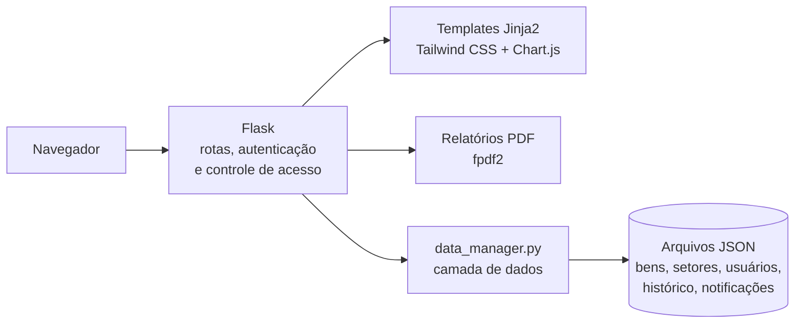

# Sistema de Gestão de Patrimônio

Aplicação web para controlar os bens patrimoniais de um órgão público por setor: cadastro, transferências entre setores, histórico de movimentações, notificações, painel com indicadores e relatórios em PDF, com controle de acesso por perfil de usuário.


## O problema

Em órgãos com dezenas de setores, o controle de patrimônio costuma ficar espalhado em planilhas: não se sabe com certeza onde está cada bem, quem o transferiu e quando, e montar um relatório por setor leva tempo. Este sistema centraliza essas informações, registra cada movimentação e mostra a situação do patrimônio em tempo real.

## Funcionalidades

- **Cadastro de bens** com número de patrimônio, descrição, setor, data de aquisição e condição
- **Transferência entre setores**, com registro automático no histórico
- **Histórico completo** de cadastros, edições, transferências e exclusões, com data, hora e responsável
- **Painel com indicadores**: total de bens, distribuição por setor e por condição e atividade diária, com gráficos
- **Notificações** para o administrador a cada movimentação relevante
- **Relatórios em PDF** filtrados por setor
- **Gestão de setores e usuários**, com 27 setores pré-cadastrados

## Perfis de acesso

| Funcionalidade | Administrador | Gestor | Usuário |
|---|---|---|---|
| Painel de indicadores | Todos os setores | Setores sob sua gestão | Seu setor |
| Consultar bens e histórico | Todos os setores | Setores sob sua gestão | Seu setor |
| Gerar relatório em PDF | ✅ | ✅ | ✅ |
| Cadastrar, editar, transferir e excluir bens | ✅ | – | – |
| Gerenciar setores e usuários | ✅ | – | – |
| Receber notificações | ✅ | – | – |

## Arquitetura



A camada de dados fica isolada em `data_manager.py`, o que permite trocar o armazenamento em JSON por um banco de dados sem alterar as rotas da aplicação.

## Segurança

- Senhas armazenadas apenas como hash (scrypt, via Werkzeug)
- Controle de acesso por perfil e por setor em todas as rotas, com páginas de erro 403 e 404
- Chave de sessão lida da variável de ambiente `FLASK_SECRET_KEY`
- Modo de depuração desativado por padrão
- Registro de eventos em log para auditoria

## Como executar

```bash
git clone https://github.com/gabrieldeoliver1/sistema-de-patrimonio.git
cd sistema-de-patrimonio
pip install -r requirements.txt
python app_patrimonio.py
```

Acesse `http://127.0.0.1:5000`. O repositório inclui dados de demonstração e três usuários de teste, todos com a senha `demo123`:

| Usuário | Perfil |
|---|---|
| `admin` | Administrador |
| `gestor` | Gestor (ASTEC e ASCOR) |
| `usuario` | Usuário (ASTEC) |

Em produção, defina `FLASK_SECRET_KEY` com um valor aleatório e troque as senhas de demonstração.

## Estrutura do projeto

```
├── app_patrimonio.py      # Rotas, autenticação, controle de acesso e relatórios em PDF
├── data_manager.py        # Leitura e gravação dos dados
├── templates/             # Páginas em Jinja2
├── static/css/            # Estilos
├── *.json                 # Dados de demonstração
└── DejaVuSans*.ttf        # Fontes com suporte a acentos nos PDFs
```

## Próximos passos

- Migrar o armazenamento de JSON para SQLite ou PostgreSQL
- Adicionar testes automatizados das regras de acesso
- Empacotar com Docker e publicar uma versão de demonstração online
- Exportar relatórios também em Excel

## Créditos

As fontes DejaVu são distribuídas sob a licença livre do projeto [DejaVu Fonts](https://dejavu-fonts.github.io/License.html).

## 🔗 Contato

[](https://www.linkedin.com/in/gabrieldeoliver1/)

Email: gabrieldeoliver1@gmail.com
